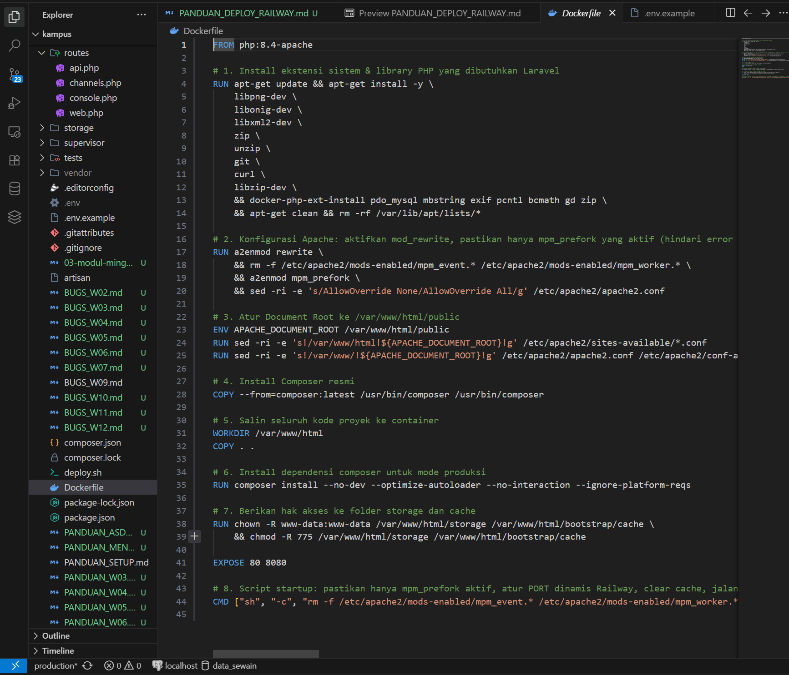
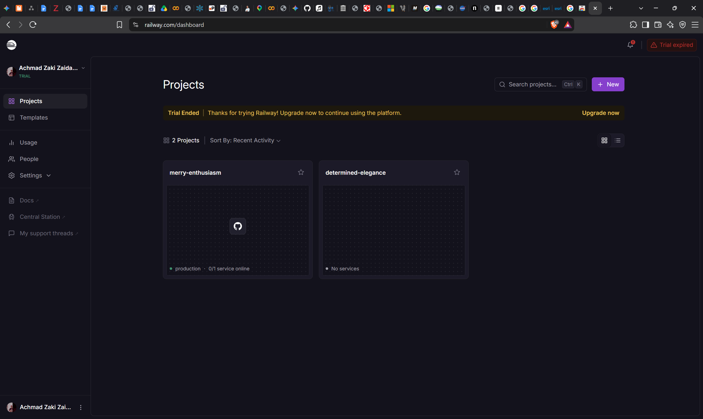
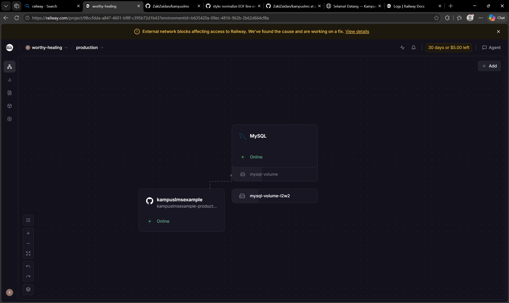
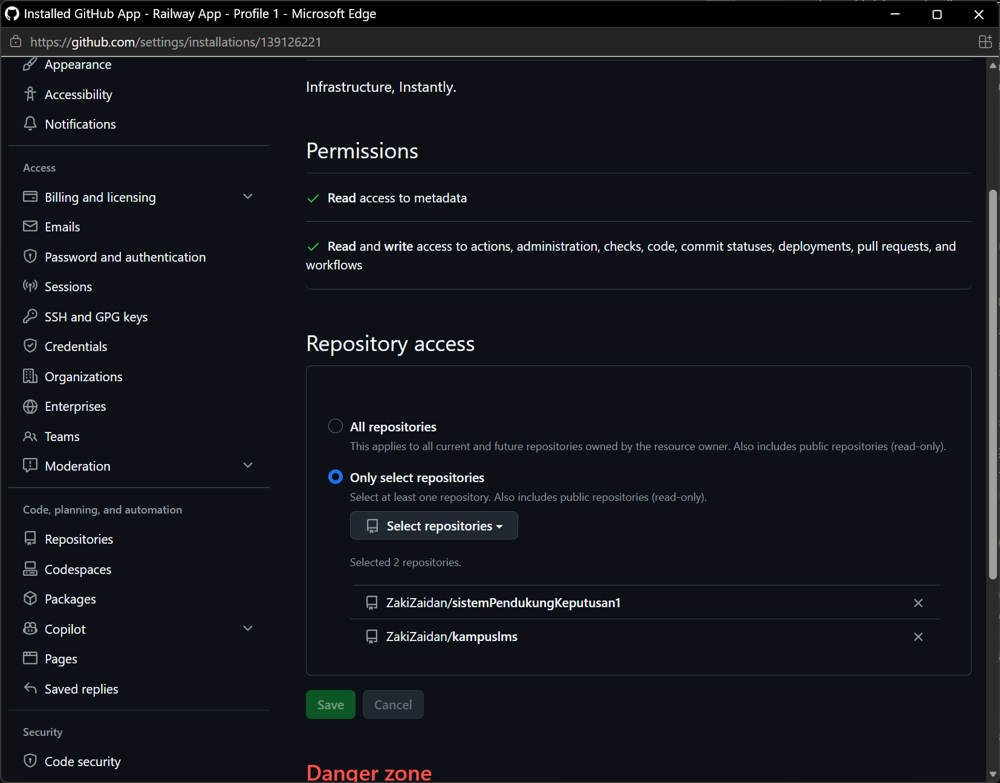
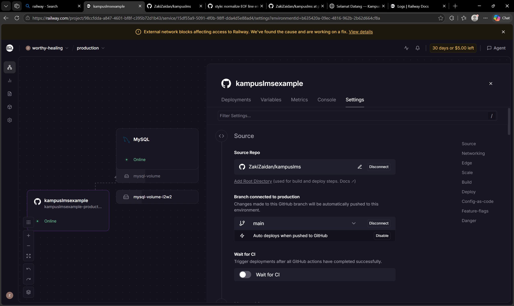
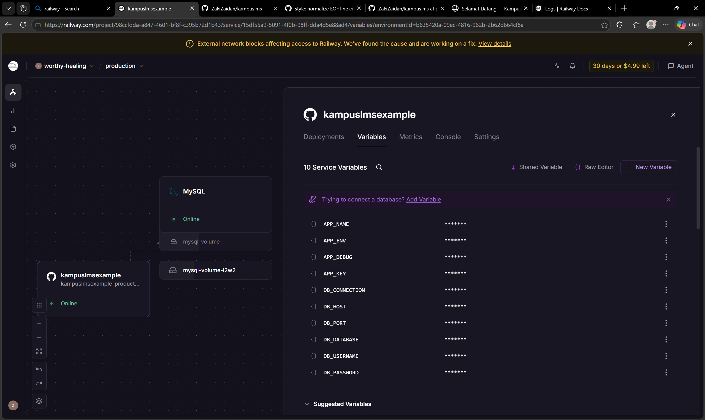
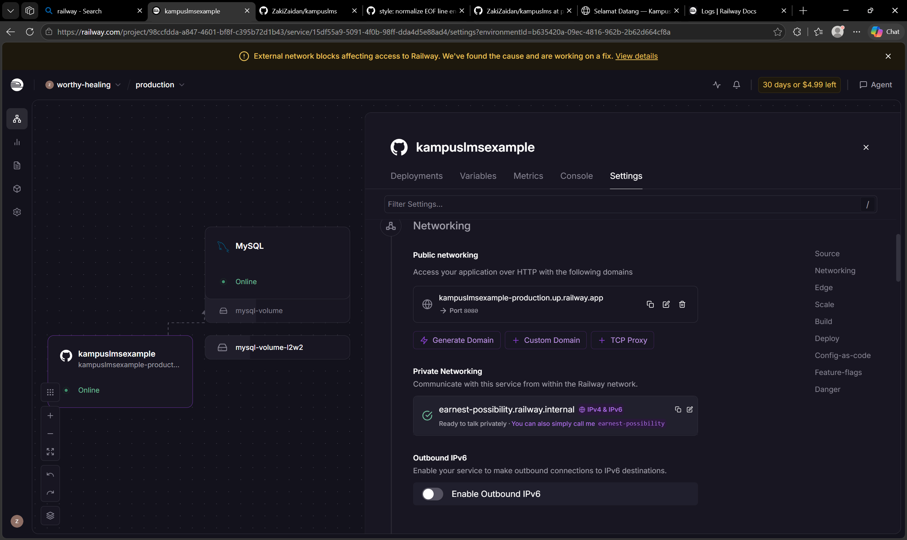
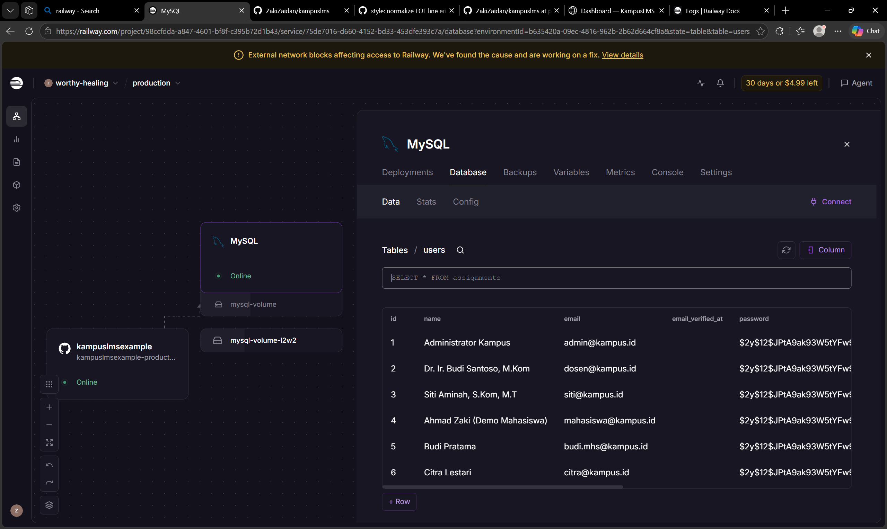
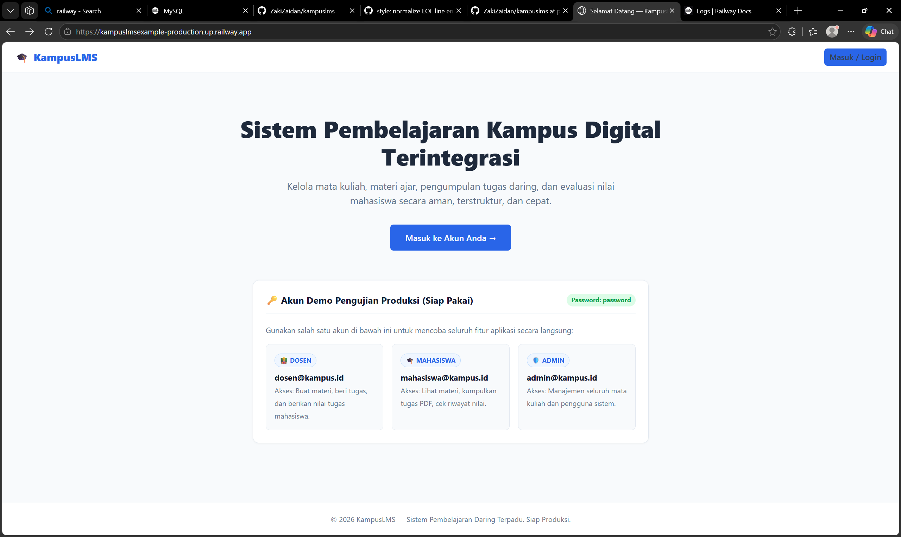

# Panduan Lengkap Deployment KampusLMS di Railway.app

Panduan ini berisi langkah-langkah praktis untuk mendeploy aplikasi Laravel 12 **KampusLMS** bersama database **MySQL bawaan Railway** secara terintegrasi dalam satu project, lengkap dengan solusi untuk berbagai kendala (troubleshooting) yang sering terjadi di lapangan.

---

## Daftar Isi
1. [Langkah 1: Menyiapkan File `Dockerfile` Siap Produksi](#langkah-1-menyiapkan-file-dockerfile-siap-produksi)
2. [Langkah 2: Membuat Project Baru di Railway.app](#langkah-2-membuat-project-baru-di-railwayapp)
3. [Langkah 3: Menambahkan Database MySQL di Railway (1-Click)](#langkah-3-menambahkan-database-mysql-di-railway-1-click)
4. [Langkah 4: Menghubungkan Repository GitHub KampusLMS](#langkah-4-menghubungkan-repository-github-kampuslms)
5. [Langkah 5: Mengonfigurasi Environment Variables](#langkah-5-mengonfigurasi-environment-variables)
6. [Langkah 6: Menghasilkan Domain Publik (HTTPS)](#langkah-6-menghasilkan-domain-publik-https)
7. [Langkah 7: Migrasi & Seeding Otomatis Database](#langkah-7-migrasi--seeding-otomatis-database)
8. [Langkah 8: Pengujian Aplikasi Live & Akun Demo](#langkah-8-pengujian-aplikasi-live--akun-demo)
9. [Troubleshooting: Kasus-Kasus Error yang Sering Terjadi & Solusinya](#-troubleshooting-kasus-kasus-error-yang-sering-terjadi--solusinya)

---

## Langkah 1: Menyiapkan File `Dockerfile` Siap Produksi

Railway mendukung deployment otomatis berbasis Dockerfile. Karena proyek ini menggunakan **Laravel 12** yang membutuhkan **PHP $\ge$ 8.4**, pastikan file `Dockerfile` di akar (*root*) proyek Anda menggunakan konfigurasi terbaru yang bebas konflik MPM dan port dinamis.

Simpan file **`Dockerfile`** di root folder proyek:

```dockerfile
FROM php:8.4-apache

# 1. Install ekstensi sistem & library PHP yang dibutuhkan Laravel
RUN apt-get update && apt-get install -y \
    libpng-dev \
    libonig-dev \
    libxml2-dev \
    zip \
    unzip \
    git \
    curl \
    libzip-dev \
    && docker-php-ext-install pdo_mysql mbstring exif pcntl bcmath gd zip \
    && apt-get clean && rm -rf /var/lib/apt/lists/*

# 2. Konfigurasi Apache: aktifkan mod_rewrite, pastikan hanya mpm_prefork yang aktif (hindari error More than one MPM loaded)
RUN a2enmod rewrite \
    && rm -f /etc/apache2/mods-enabled/mpm_event.* /etc/apache2/mods-enabled/mpm_worker.* \
    && a2enmod mpm_prefork \
    && sed -ri -e 's/AllowOverride None/AllowOverride All/g' /etc/apache2/apache2.conf

# 3. Atur Document Root ke /var/www/html/public
ENV APACHE_DOCUMENT_ROOT /var/www/html/public
RUN sed -ri -e 's!/var/www/html!${APACHE_DOCUMENT_ROOT}!g' /etc/apache2/sites-available/*.conf
RUN sed -ri -e 's!/var/www/!${APACHE_DOCUMENT_ROOT}!g' /etc/apache2/apache2.conf /etc/apache2/conf-available/*.conf

# 4. Install Composer resmi
COPY --from=composer:latest /usr/bin/composer /usr/bin/composer

# 5. Salin seluruh kode proyek ke container
WORKDIR /var/www/html
COPY . .

# 6. Install dependensi composer untuk mode produksi (tambahkan --ignore-platform-reqs agar selalu kompatibel)
RUN composer install --no-dev --optimize-autoloader --no-interaction --ignore-platform-reqs

# 7. Berikan hak akses ke folder storage dan cache
RUN chown -R www-data:www-data /var/www/html/storage /var/www/html/bootstrap/cache \
    && chmod -R 775 /var/www/html/storage /var/www/html/bootstrap/cache

EXPOSE 80 8080

# 8. Script startup: pastikan hanya mpm_prefork aktif, atur PORT dinamis Railway, clear cache, jalankan migrasi & seed, lalu jalankan Apache
CMD ["sh", "-c", "rm -f /etc/apache2/mods-enabled/mpm_event.* /etc/apache2/mods-enabled/mpm_worker.* && export PORT=\"${PORT:-8080}\" && sed -i \"s/Listen .*/Listen $PORT/\" /etc/apache2/ports.conf && sed -i \"s/<VirtualHost \\*:.*>/<VirtualHost \\*:$PORT>/\" /etc/apache2/sites-available/000-default.conf && php artisan config:clear && php artisan route:clear && php artisan view:clear && (php artisan migrate --force || true) && (php artisan db:seed --force || true) && exec apache2-foreground"]
```

Commit dan push ke GitHub (baik branch `production` maupun `main`):
```bash
git add Dockerfile
git commit -m "fix(docker): production-ready Dockerfile for PHP 8.4 with auto-seed and dynamic port"
git push origin main
git push origin production
```



---

## Langkah 2: Membuat Project Baru di Railway.app

1. Buka situs [https://railway.app](https://railway.app).
2. Login menggunakan akun **GitHub** Anda.
3. Di dashboard utama, klik tombol **"New Project"** (atau tombol **"+ Create a New Project"**) berwarna ungu.


> **keterangan:**
> screenshoot ini dari akun saya karena saya sudah punya akun di railway dan sudah login

---

## Langkah 3: Menambahkan Database MySQL di Railway (1-Click)

1. Pada menu pilihan layanan, pilih **"Provision MySQL"** (atau klik tombol **`+`** di menu kanan kanvas $\rightarrow$ **Database** $\rightarrow$ **Add MySQL**).
2. Railway otomatis membuat satu service MySQL di dalam kanvas proyek Anda dalam waktu ~5 detik dengan status hijau (**Online**).
3. Anda tidak perlu membuat tabel manual melalui menu database, karena Laravel akan mengisinya secara otomatis.


> 📸 **keterangan:**
> perhatikan gambar kotak dengan logo mysql dengan status online, jika anda sudah berhasil menambahkan mysql kedalam workpage railway tampilannya akan seperti itu (abaikan kotak yang ada tulisan $mysql-volueme karena itu adalah data dari database sebelumnya).

---

## Langkah 4: Menghubungkan Repository GitHub KampusLMS

1. Di dalam kanvas proyek yang sama, klik tombol **"+ Create"** (atau tombol **`+`** di menu kanan kanvas).
2. Pilih opsi **"GitHub Repo"**.
3. Cari dan pilih repository proyek **`kampuslms`** Anda.
4. Pastikan branch yang terhubung adalah **`main`**.
5. Klik **"Deploy Now"**.
6. Lalu setelah berhasil Klik kotak dengan logo github pastikan repository benar dan branch main. serta jika auto deploys tidak otomatis aktif maka aktifkan dengan mengklik tombol "+ Toggle Auto Deploy"
7. Kalau repositori tidak ada dalam daftar, klik **"Configure GitHub App"** di bawah daftar repository dan dibagian repository access pilih only select repositories dan pilih repository kampuslms yang ada. Setelah terhubung, ulangi langkah 3-5.



> 📸 **keterangan:**
> perhatikan gambar kotak dengan logo kampuslms dengan status online, jika anda sudah berhasil menghubungkan github repo kampuslms kedalam workpage railway tampilannya akan seperti itu (abaikan kotak yang ada tulisan $mysql-volueme karena itu adalah data dari database sebelumnya).

---

## Langkah 5: Mengonfigurasi Environment Variables

Agar Laravel terhubung ke database MySQL Railway dan berjalan dalam mode produksi yang aman:

1. Klik service aplikasi web **KampusLMS** di kanvas.
2. Buka tab **"Variables"**.
3. Klik tombol **"Raw Editor"** (atau tambahkan satu per satu):

```env
APP_NAME=KampusLMS
APP_ENV=production
APP_KEY=base64:yXMLWauESwOYJgA6SgjpZiDSVcnEruvAAY4m1+OW0Hk=
APP_DEBUG=false
APP_URL=https://${{RAILWAY_PUBLIC_DOMAIN}}

DB_CONNECTION=mysql
DB_HOST=${{MySQL.MYSQLHOST}}
DB_PORT=${{MySQL.MYSQLPORT}}
DB_DATABASE=${{MySQL.MYSQLDATABASE}}
DB_USERNAME=${{MySQL.MYSQLUSER}}
DB_PASSWORD=${{MySQL.MYSQLPASSWORD}}

SESSION_DRIVER=database
QUEUE_CONNECTION=database
FILESYSTEM_DISK=local
```

> 💡 **Fitur Canggih Railway:** Penulisan `${{MySQL.MYSQLHOST}}` otomatis menarik alamat host internal dari service MySQL yang kita buat di Langkah 3. Koneksi antar-service ini gratis bandwidth, aman dari internet luar, dan sangat cepat!


> 📸 **Keterangan:**
> jika sudah berhasil tampilannya akan seperti ini.

---

## Langkah 6: Menghasilkan Domain Publik (HTTPS)

Secara default, service di Railway belum memiliki URL publik sampai Anda mengaktifkannya:

1. Masih di service aplikasi **KampusLMS**, buka tab **"Settings"**.
2. Gulir ke bawah hingga bagian **"Networking"** $\rightarrow$ **"Public Networking"**.
3. Klik tombol **"Generate Domain"**.
4. Jika muncul kotak dialog *"Enter the port your app is listening on"*:
   - Masukkan angka: **`8080`** (port standar yang sudah dikonfigurasi di `Dockerfile`).
   - Klik tombol **"Generate Domain"**.
5. Railway akan membuatkan domain gratis berekstensi `.up.railway.app` lengkap dengan sertifikat SSL/HTTPS aktif (contoh: `kampuslms-production.up.railway.app`).


> 📸 **Keterangan:**
> jika sudah berhasil tampilannya akan seperti ini.

---

## Langkah 7: Migrasi & Seeding Otomatis Database

Di file `Dockerfile` terbaru kita, perintah migrasi dan seeding data demo sudah otomatis dieksekusi saat container pertama kali menyala:
```bash
php artisan migrate --force && php artisan db:seed --force
```

Jika Anda ingin memeriksa migrate & seed database sudah berjalan atau tidak:
1. Di kanvas sebelah kiri, klik kotak MySQL (service database Anda yang berwarna hijau).
2. Buka tab Database (lalu klik sub-tab Data).
3. Di sisi kiri akan muncul daftar tabel yang sudah dibuat:
4. Klik tabel users → Anda akan melihat akun admin@kampus.id, dosen@kampus.id, dan mahasiswa@kampus.id.
4. Klik tabel lainnya anda akan melihat data lainnya.


> 📸 **Panduan Screenshot:**
> contoh data user yang berhasil masuk.

---

## Langkah 8: Pengujian Aplikasi Live & Akun Demo

1. Buka domain yang dihasilkan di Langkah 6 pada browser Anda (misal `https://kampuslms-production.up.railway.app`).
2. Pastikan halaman website sesuai dengan yang anda buat di local dan testing fungsi fungsi yang ada di dalamnya apakah sudah sesuai atau belum, silahkan debugging sesuai dengan fitur website masing masing


> 📸 **keterangan:**
> jika tampilan website sudah sesuai dengan yang anda buat di local maka selamat anda sudah berhasil deploy kampuslms di railway.

---

## Troubleshooting: Kasus-Kasus Error yang Sering Terjadi & Solusinya

Berikut adalah rangkuman masalah nyata yang paling sering ditemui saat deployment di Railway beserta langkah penyelesaiannya:

---

### Kasus 1: Error `composer install` Versi PHP Tidak Cocok
* **Pesan Error di Build Logs:**
  ```text
  symfony/clock v8.1.0 requires php >=8.4.1 -> your php version (8.3.36) does not satisfy that requirement.
  Build Failed: process "composer install" did not complete successfully: exit code 2
  ```
* **Penyebab:**
  Laravel 12 menyertakan komponen Symfony 8 yang membutuhkan minimal PHP 8.4.1. Jika `Dockerfile` memakai `php:8.3-apache`, Composer akan menolak melakukan instalasi.
* **Solusi:**
  1. Ganti baris pertama `Dockerfile` menjadi: `FROM php:8.4-apache`.
  2. Tambahkan opsi `--ignore-platform-reqs` pada baris `composer install` agar tidak digagalkan oleh perbedaan minor versi PHP di mesin build.

---

### Kasus 2: Apache Crash `AH00534: More than one MPM loaded`
* **Pesan Error di Deploy Logs:**
  ```text
  AH00534: apache2: Configuration error: More than one MPM loaded.
  ```
* **Penyebab:**
  Di Linux Debian, Apache memiliki modul pemrosesan `mpm_prefork`, `mpm_worker`, dan `mpm_event`. Apache hanya mengizinkan **satu** MPM aktif. Ketika paket sistem diperbarui, `mpm_event` otomatis aktif di samping `mpm_prefork`, memicu konflik modul ganda.
* **Solusi:**
  Pastikan modul selain prefork dihapus di `Dockerfile`:
  ```dockerfile
  RUN a2enmod rewrite \
      && rm -f /etc/apache2/mods-enabled/mpm_event.* /etc/apache2/mods-enabled/mpm_worker.* \
      && a2enmod mpm_prefork
  ```
  Dan tambahkan perintah pembersihan yang sama di baris `CMD` sebelum Apache dijalankan.

---

### Kasus 3: `Could not load branches. Retry` atau `Auto deploy unavailable`
* **Pesan Error di Settings / Branch:**
  ```text
  Could not load branches. Retry
  Auto deploy unavailable: This is a public repository without a Railway GitHub App installation.
  ```
* **Penyebab:**
  1. Sedang terjadi kendala jaringan eksternal antara Railway dan GitHub API (*"External network blocks affecting access to Railway"*).
  2. Repository GitHub belum memiliki izin webhook dari Railway GitHub App, sehingga Railway tidak otomatis menarik commit baru saat Anda melakukan `git push`.
* **Solusi Cepat (Hanya 10 Detik):**
  1. Jika dropdown branch terkunci di `main`, cukup push kode Anda ke branch `main`:
     ```bash
     git push origin production:main
     ```
  2. Buka tab **Settings** $\rightarrow$ klik **`Disconnect`** pada baris repository $\rightarrow$ klik **`Connect Repo`** ulang dan pilih kembali repo Anda. Ini memaksa Railway langsung mengunduh commit paling segar.

---

### Kasus 4: Error `Application failed to respond` (502 Bad Gateway)
* **Pesan Error di Halaman Browser:**
  ```text
  Application failed to respond (502 Bad Gateway)
  Request ID: ...
  ```
* **Penyebab:**
  1. **Port Mismatch:** Domain publik Railway diarahkan ke port yang salah (bukan port yang didengarkan oleh web server).
  2. **Service Sedang Crash:** Konfigurasi environment variables belum lengkap atau `APP_KEY` kosong.
* **Solusi:**
  1. Buka tab **Settings** $\rightarrow$ **Networking** $\rightarrow$ pastikan port target adalah **`8080`**.
  2. Buka tab **Variables** $\rightarrow$ pastikan variabel `APP_KEY` dan `DB_HOST` sampai `DB_PASSWORD` sudah terisi dengan benar.
  3. Buka tab **Deploy Logs** untuk melihat pesan error spesifik jika status container masih *Crashed*.

---

### Kasus 5: Tombol "Deploy" / "Redeploy" Tidak Muncul di Dashboard
* **Penyebab:**
  Anda sedang membuka tampilan rincian log kesalahan (layar *drill-down*), sehingga tombol aksi utama tersembunyi.
* **Solusi:**
  1. **Paling Cepat via Keyboard:** Tekan **`Ctrl + K`** (atau `Cmd + K`), ketik **`redeploy`**, lalu tekan **Enter**.
  2. **Via Mouse:** Klik tanda silang kecil **`✕`** di pojok kiri/kanan atas kotak log error untuk kembali ke daftar riwayat deployment. Di baris deployment paling atas, klik ikon titik tiga **`...`** $\rightarrow$ pilih **`Redeploy`**.

---

### Kasus 6: Halaman Sub-Menu (Login, Dashboard, Matkul) Error 404 Not Found
* **Pesan Error di Browser:**
  ```text
  404 Not Found - The requested URL was not found on this server.
  ```
* **Penyebab:**
  Konfigurasi Apache belum mengaktifkan modul `rewrite` atau direktif `AllowOverride All`, sehingga file `.htaccess` milik Laravel diabaikan dan semua request selain `/` dianggap direktori fisik yang tidak ada.
* **Solusi:**
  Di dalam `Dockerfile`, pastikan terdapat baris:
  ```dockerfile
  RUN a2enmod rewrite \
      && sed -ri -e 's/AllowOverride None/AllowOverride All/g' /etc/apache2/apache2.conf
  ```

---

### Kasus 7: Error `SQLSTATE[01000]: Warning: 1265 Data truncated for column 'status' at row 1` saat Seeding Database
* **Pesan Error di Console:**
  ```text
  SQLSTATE[01000]: Warning: 1265 Data truncated for column 'status' at row 1 (Connection: mysql, SQL: insert into 'courses' ... values (..., published, ...))
  ```
* **Penyebab:**
  File `DatabaseSeeder.php` mencoba memasukkan nilai yang tidak terdaftar pada tipe data kolom `ENUM('draft', 'active', 'archived')` pada tabel `courses` (misalnya string `'published'`). MySQL dengan mode ketat (*strict mode*) akan menolak dan membatalkan query jika nilai enum tidak sesuai definisi skema migrasi.
* **Solusi:**
  Gunakan nilai status enum yang sah sesuai skema tabel, yaitu **`active`**, bukan `published`. Buka `database/seeders/DatabaseSeeder.php` dan pastikan data demo mata kuliah menggunakan `'status' => 'active'`.

---

## Ringkasan Pemeriksaan Keamanan Produksi
- [x] Dokumen root mengarah secara ketat ke `/public` melalui Apache VirtualHost.
- [x] Hak akses direktori storage dan cache dibatasi ke pengguna `www-data:www-data` (`775`).
- [x] `APP_DEBUG=false` untuk mencegah kebocoran informasi stack-trace sensitif.
- [x] Port database MySQL terisolasi dalam private network internal `${{MySQL.MYSQLHOST}}` (tidak dapat di-scan dari internet publik).
- [x] Enkripsi SSL/HTTPS otomatis aktif dari Railway edge proxy.
